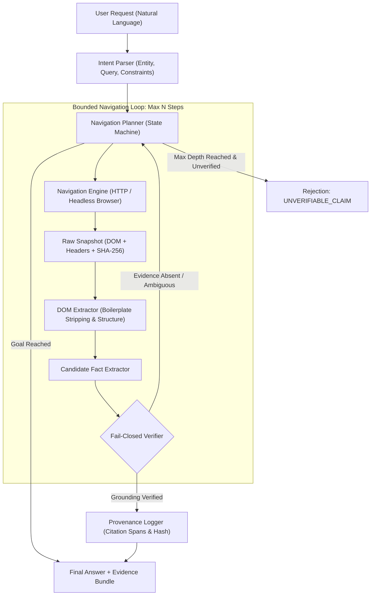

# System Architecture — AMD ROCm Local-First Web Retrieval Agent

## 1. Architectural Principles
1. **Local-First & Offline-Capable:** No reliance on proprietary paid cloud APIs. Inference runs locally on AMD GPUs using ROCm / HIP.
2. **Fail-Closed Governance:** If extracted data cannot be mathematically verified against the rendered page DOM, return an explicit failure rather than guessing.
3. **Cryptographic Provenance:** Every retrieved token is linked to a SHA-256 checksummed snapshot of the web resource.
4. **Deterministic Sandboxing:** Navigation is state-machine controlled, preventing runaway crawl loops or denial-of-service conditions.

---

## 2. Component Pipeline



---

## 3. Subsystem Breakdown

### 3.1. Intent Parser (`src/parser/intent_parser.py`)
- Analyzes the natural language query into:
  - `target_entity`: The subject being investigated.
  - `target_attributes`: Specific fields or metrics requested (e.g., date, price, version, definition).
  - `seed_url`: Initial starting point URL, either provided explicitly or resolved via query analysis.
  - `constraints`: Scope, temporal filters, or data format requirements.

### 3.2. Bounded Navigation Planner (`src/planner/navigation_planner.py`)
- Formulates a sequence of `NavigationStep` actions:
  - `VISIT_URL`: Navigate to seed or explicit link.
  - `FOLLOW_LINK`: Select high-relevance internal anchor matching target intent keywords.
  - `PAGINATE`: Advance multi-page tables.
- **Safety Invariants:**
  - Maximum navigation depth: Default 5 hops.
  - Domain lock: Cannot stray into external untrusted domains.
  - History loop guard: Never revisit previously evaluated canonical URLs.

### 3.3. Navigation & Snapshot Engine (`src/browser/navigation_engine.py`)
- Abstracts network communication with retry backoff and timeout bounding (default 15s).
- Captures `DOMSnapshot` containing:
  - `url`: Canonical fetched URL.
  - `status_code`: HTTP response code.
  - `raw_html`: Raw page payload.
  - `content_hash`: SHA-256 digest of raw payload.
  - `timestamp`: UTC ISO-8601 timestamp.

### 3.4. DOM Content Extractor (`src/extractor/dom_extractor.py`)
- Sanitizes and distills messy HTML into high-density semantic text:
  - Strips non-content nodes (`<script>`, `<style>`, `<nav>`, `<footer>`, `ads`, `<svg>`).
  - Converts tables (`<table>`) into structured dictionary rows and markdown tables.
  - Preserves hierarchical headings (`<h1>`–`<h6>`) and anchor link relationships.

### 3.5. Fail-Closed Verifier (`src/verifier/fail_closed_verifier.py`)
- The anti-hallucination guardrail of the agent.
- Given candidate answer string $A$ and page content $C$:
  - Checks for exact substring inclusion ($A \subset C$) or high-fidelity token span match (ratio $\ge 0.90$).
  - Locates start and end character offsets within $C$.
  - Computes `VerificationStatus.VERIFIED` if found; otherwise flags `VerificationStatus.REJECTED_UNVERIFIED`.
- If an extracted fact cannot be proven from the snapshot, the agent **fails closed**, outputting:
  ```json
  {
    "status": "FAIL_CLOSED",
    "reason": "CLAIM_NOT_FOUND_IN_EVIDENCE",
    "query": "..."
  }
  ```

### 3.6. Provenance Tracker (`src/provenance/tracker.py`)
- Builds an immutable audit trail (`ProvenanceRecord`):
  - `snapshot_sha256`: Hash of source DOM.
  - `source_url`: URL where the fact was obtained.
  - `char_offset_start` / `char_offset_end`: Exact offset of cited text.
  - `verbatim_quote`: Verbatim grounding excerpt.
  - `timestamp`: Time of capture.

---

## 4. AMD / ROCm Hardware Execution Strategy
- **Target Accelerators:** AMD Radeon RX series (RDNA3/RDNA4), AMD Instinct MI series (CDNA2/CDNA3).
- **Execution Backends:**
  - `torch` with ROCm 6.x (`hip`).
  - Small Language Model Serving: `llama.cpp` built with `LLAMA_HIPBLAS=ON` or `vLLM` with ROCm container.
  - Quantization: GGUF Q4_K_M / Q8_0 or AWQ for minimal VRAM footprint (< 6GB).
  - CPU Fallback: Automated degradation to optimized CPU inference if no ROCm device is visible.
